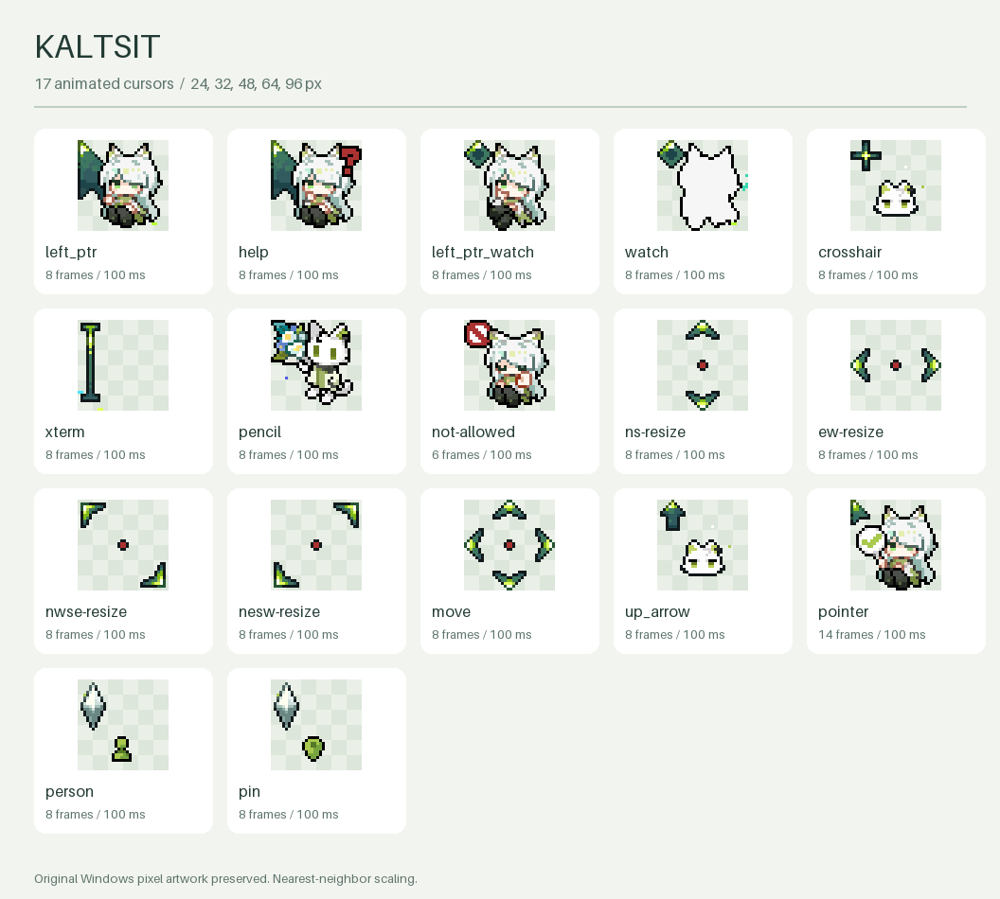

# Kaltsit cursors · 凯尔希 · 思衡托

Linux 动态鼠标主题，移植自 **[一球咸鱼](https://space.bilibili.com/3585839)** 的
Windows 版 **[凯尔希 · 思衡托](https://www.bilibili.com/video/BV1L5Vq6vEaX/)**。
原作者已同意将 Linux 适配版提交到 nixpkgs，约定署名、链接原作品及非商业用途。
授权记录见 [CREDITS.md](CREDITS.md)，许可范围见 [LICENSE](LICENSE)。

An unofficial animated Kal'tsit Xcursor theme for Linux, adapted from the
original Windows pixel artwork by 一球咸鱼 with permission for this
non-commercial Linux adaptation and its nixpkgs submission.




## 主题内容

- 17 种原始动态光标，保留原始热点、透明度、动画顺序和 100 ms 帧时长。
- 68 个 Linux/X11/GTK/Qt 名称别名；包含默认、链接、文本、忙碌、帮助、移动和各方向缩放。
- 24、32、48、64、96 像素五种尺寸；原图为 32×32，采用最近邻缩放保留像素风格。
- `person`、`pin` 保留为扩展名称；平台未使用这些名称时不会显示。
- 原作未提供的特殊状态通过 `Adwaita,hicolor` 继承；应用或合成器可能自带某些光标。

## 安装预构建主题

下载并解压本项目提供的 Linux 主题压缩包，在解压目录运行：

```sh
sh install.sh
```

主题安装到 `${XDG_DATA_HOME:-$HOME/.local/share}/icons/Kaltsit`。
随后在 KDE Plasma 的「系统设置 → 颜色和主题 → 光标」中选择 **Kaltsit**。
GNOME 可用 Tweaks 选择，或运行：

```sh
gsettings set org.gnome.desktop.interface cursor-theme 'Kaltsit'
gsettings set org.gnome.desktop.interface cursor-size 32
```

安装脚本只复制主题文件。已有同名主题会备份为 `Kaltsit.backup.*/Kaltsit`。
有些已启动的应用需要重启，桌面设置未刷新时可重新登录。

卸载本脚本安装的主题：

```sh
sh install.sh --uninstall
```

可以用 `--prefix /absolute/path/to/icons` 指定目录。卸载后请在桌面设置中切换主题。

## 从原始文件构建

需要 Python 3.10+ 和 Pillow 10.1+；不需要 Wine、ImageMagick 或 xcursorgen。

```sh
python3 -m venv .venv
. .venv/bin/activate
python3 -m pip install -r requirements.txt
python3 tools/build_theme.py
python3 -m unittest discover -s tests -v
```

默认输出 `theme/Kaltsit`。自定义尺寸：

```sh
python3 tools/build_theme.py --sizes 32 64 --output build/Kaltsit
```

`cursors.json` 定义 Windows 文件与 Linux 光标名称映射。
`theme/Kaltsit/build-report.json` 记录来源 SHA-256、逐帧尺寸、热点和时长。
原始 `.ani` 按字节保留；`assets/windows/install.inf` 只记录原始映射，不会执行。

可选原生格式验证会通过 libXcursor 读取每帧；系统无法发现库时，设置
`XCURSOR_TEST_LIBRARY=/absolute/path/to/libXcursor.so.1` 后再运行测试。
重新生成预览：`python3 tools/preview.py`。

## NixOS / Home Manager

本仓库提供独立 Nix 构建；这里的命令不依赖主题已经被 nixpkgs 收录。

```sh
nix-build
```

产物位于 `result/share/icons/Kaltsit`，构建会重新转换原素材并运行测试。
NixOS 配置可引用本地项目：

```nix
{ pkgs, ... }:
{
  environment.systemPackages = [
    (import ./kaltsit-cursors/default.nix { inherit pkgs; })
  ];
}
```

把路径替换为实际项目路径，再在 Plasma 设置中选择 Kaltsit。
Home Manager 示例：

```nix
{ pkgs, ... }:
{
  home.pointerCursor = {
    package = import ./kaltsit-cursors/default.nix { inherit pkgs; };
    name = "Kaltsit";
    size = 32;
    gtk.enable = true;
    x11.enable = true;
  };
}
```

Plasma 和 Wayland 合成器可能有各自的光标选项，仍需在对应桌面设置中选择主题。
素材并非自由许可；nixpkgs 包按 `unfree` 处理，不推定为可任意再分发的素材。

## 开发与许可

`tools/cursorlib.py` 读取 CUR/ANI、AND 透明蒙版、热点、`seq`/`rate`；
`tools/xcursor.py` 写入多尺寸、多帧 Xcursor，并预乘透明度。
不支持无法用 RGBA 表达的屏幕反色 XOR 像素，遇到时会明确报错。

转换代码、测试与安装工具使用 MIT；原始及转换后图像遵循原作者的具体授权。
请保留作者署名、原作链接和许可说明。
